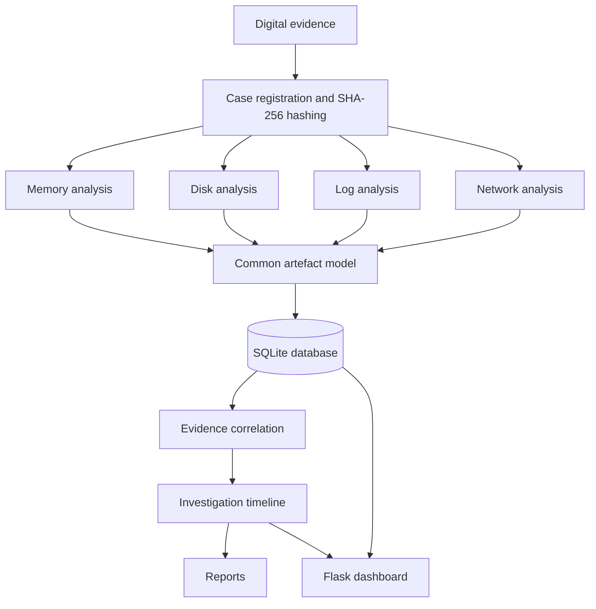

ForensicLens
Digital Forensics & Evidence Analysis Toolkit


ForensicLens is a Python-based Digital Forensics and Incident Response (DFIR) toolkit for examining digital evidence and organizing investigation findings. It brings memory, disk, network and log examination into a common case-based workflow.
This repository is an educational adaptation of TraceForge V2. It is intended for learning, laboratory investigations and forensic workflow evaluation.
Overview
A forensic investigation often requires examining multiple evidence sources independently. ForensicLens provides a common interface for collecting the results of these examinations, identifying relationships between events and preparing case reports.
Features
Module	Purpose
Memory forensics	Examine processes, network connections and command-line artefacts using Volatility 3.
Disk forensics	Inspect file metadata, timestamps and deleted-file indicators using dfVFS.
Log analysis	Identify authentication activity, privilege-related events and repeated failed login attempts.
Network forensics	Examine packet captures, DNS activity, HTTP requests and TCP flows using Scapy.
Evidence management	Record SHA-256 hashes and evidence registration details in SQLite.
Correlation	Associate artefacts using timestamps, IP addresses and host identifiers.
Timeline	Review investigation events in chronological order.
Reporting	Export case findings in JSON, HTML and PDF.
Dashboard	Browse cases, evidence, timelines and correlation results.
Architecture

Technology Stack
Component	Technology
Language	Python 3.11
User interface	Flask, Jinja2
Command-line interface	Click, Rich
Database	SQLite
Memory examination	Volatility 3
Disk examination	dfVFS
Packet examination	Scapy
Reports	Jinja2, WeasyPrint
Testing	pytest
Deployment	Docker, Docker Compose
Project Structure
```text
ForensicLens/
├── traceforge/           # Original Python package
│   ├── __main__.py       # Interactive entry point
│   ├── cli.py            # Command-line commands
│   ├── launcher.py       # Interactive menu
│   ├── core/             # Evidence ledger, storage and reporting
│   └── modules/          # Memory, disk, logs and network analysis
├── dashboard/
│   ├── app.py            # Flask application
│   └── templates/        # Dashboard pages
├── tests/                # Upstream test suite
├── Dockerfile
├── docker-compose.yml
├── requirements.txt
├── LICENSE
└── README.md
```
The repository is named ForensicLens, but the upstream Python import name remains `traceforge`. Use that name when running the application.
Getting Started
Prerequisites
Ubuntu 22.04 LTS (native Linux, virtual machine or WSL2 on Windows)
Python 3.11 and Git
Sufficient disk space for forensic images and reports
Docker and Docker Compose, if using the container option
Local installation
Run the following in an Ubuntu terminal. If you already have the source code locally, skip the clone step and navigate to your existing project directory.
```bash
git clone https://github.com/saimani21/ForensicLens.git
cd ForensicLens
```
Install the native dependencies used by the upstream project:
```bash
sudo apt update
sudo apt install -y build-essential python3.11 python3.11-venv python3.11-dev \
  git tshark sleuthkit libewf-dev libvhdi-dev libvmdk-dev libbde-dev \
  libsmdev-dev libffi-dev libssl-dev pkg-config libpango-1.0-0 libpangoft2-1.0-0
```
Python 3.11 and native library availability may vary with your Linux release and configured package sources. If installation fails, check the upstream build documentation rather than substituting untested dependency versions.
```bash
python3.11 -m venv venv
source venv/bin/activate
python -m pip install --upgrade pip
python -m pip install -r requirements.txt
python -m traceforge.cli --help
```
Interactive launcher
```bash
python -m traceforge
```
Web dashboard
Start the dashboard from the repository root with the virtual environment active:
```bash
FLASK_DEBUG=false FLASK_HOST=127.0.0.1 python -m dashboard.app
```
Open http://127.0.0.1:5000 in your browser. Keep the dashboard local; it is not intended for public deployment.
Docker (optional)
The upstream repository includes a Dockerfile and Compose configuration. Build and inspect the CLI first:
```bash
docker compose build
docker compose run --rm traceforge --help
```
The included Compose dashboard may require adjustments to its host binding and mounted directory permissions. Prefer the local installation for initial testing. Before publishing any dashboard port, restrict it to localhost and ensure debug mode is disabled.
Example Investigation
Use a synthetic dataset or publicly available forensic training evidence. The example file paths below are placeholders: place your own authorized samples at these paths before running the corresponding commands.
1. Create a case
```bash
python -m traceforge.cli case new \
  --id LAB-001 --name "Forensic Investigation Lab" --analyst student
```
2. Examine available evidence
Run one or more of the following commands, depending on the evidence available:
```bash
# Authentication logs
python -m traceforge.cli logs --case LAB-001 \
  --file samples/auth.log --analyst student --host lab-host

# Packet capture
python -m traceforge.cli network --case LAB-001 \
  --pcap samples/capture.pcap --analyst student --host lab-host

# Disk image
python -m traceforge.cli disk --case LAB-001 \
  --image samples/disk.dd --analyst student --host lab-host

# Memory image
python -m traceforge.cli memory --case LAB-001 \
  --image samples/memory.raw --analyst student --host lab-host
```
3. Correlate findings and export a report
```bash
python -m traceforge.cli correlate --case LAB-001
python -m traceforge.cli report --case LAB-001 --format all --output reports
```
4. Review case information
```bash
python -m traceforge.cli case list
python -m traceforge.cli case info LAB-001
```
Inspect the dashboard and generated reports. Compare findings with independent tools where possible and document any differences, failed modules or missing artefacts.
Evidence Types
Category	Example input
Memory	`.raw`, `.mem`, `.lime`, `.vmem`
Disk	`.dd`, `.E01`, `.vmdk`, `.vhd`
Logs	`auth.log`, `syslog`, `.log`
Network	`.pcap`, `.pcapng`
Format support depends on the underlying libraries, image characteristics and available forensic symbols.
Evidence Integrity and Investigation Practice
Preserve the original evidence and work with verified copies.
Independently record SHA-256 hashes before and after examination.
Record acquisition details, analyst identity, timestamps and evidence transfers.
Treat automated correlations as investigative leads rather than proof of an incident.
Validate significant findings using independent examination methods.
The upstream SQLite ledger provides application-level evidence registration; it is not an immutable or independently audited chain-of-custody system. The default database path is `~/traceforge/data/traceforge.db`.
Testing
```bash
python -m pytest tests/ -v
```
The repository contains the upstream test suite. Test results and forensic accuracy for this adaptation have not yet been independently verified. Record the actual results from your environment before claiming successful validation.
Suggested Practice Datasets
Digital Corpora — forensic training images and scenarios.
NIST CFReDS — forensic reference datasets.
Keep private evidence, memory dumps, case databases, credentials and generated reports out of the public repository.
Limitations and Security
ForensicLens is an educational prototype, not a certified forensic examination product. It does not replace established acquisition procedures, formal evidence handling or analyst review. It does not provide dedicated mobile-device acquisition, and deleted-file indicators should not be confused with guaranteed recovery of deleted content.
Review the upstream security documentation and dependency versions before use. Run the application in an isolated lab environment, keep Flask debug mode off, and do not expose the dashboard to untrusted networks. Evidence parsers process potentially hostile files.
Attribution and License
Original project: TraceForge V2
Original developer: theconsoler
Adaptation repository: saimani21/ForensicLens
ForensicLens retains the upstream implementation and commit history. The repository name and documentation have been adapted for educational use. Original copyright and license notices are preserved in the LICENSE file. See the upstream repository for the original technical documentation and development history.
Distributed under the MIT License. Third-party libraries retain their respective licenses.
Disclaimer
Use this toolkit only for lawful, authorized investigations, academic exercises and security research. Do not collect or examine data without appropriate permission. The investigator remains responsible for evidence handling, validation and compliance with applicable requirements.
